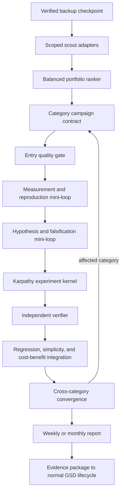

<objective>
Build a WorkspaceKit-wide AutoExperiment Control Plane that uses Karpathy's compact autoresearch kernel inside balanced, gated category mini-loops.

Purpose: improve the orchestration ecosystem as a whole without relying on manual one-off audits, while protecting current working behavior and spending subscription rate limits only where expected benefit justifies the cost.

Output: a read-only scout, portfolio ranker, adapter-based experiment kernel, backup-aware cadence controller, regression and cost-benefit judge, Markdown/token optimizer, canonical reports, cross-harness skill, and a GSD handoff for proven winners.
</objective>

<execution_plans>

| Plan | Wave | Scope |
|---|---:|---|
| `01-01-PLAN.md` | 1 | Research constitution and compatibility preflight |
| `02-01-PLAN.md` | 2 | Adapter contract, sandbox, ledger, and Karpathy kernel |
| `03-01-PLAN.md` | 3 | Balanced portfolio scheduler and nested mini-loops |
| `04-01-PLAN.md` | 4 | Non-regression, ablation, simplicity, and cost-benefit judge |
| `05-01-PLAN.md` | 5 | Backup checkpoint adapter and cadence controller |
| `06-01-PLAN.md` | 6 | Scoped ingestion, Markdown optimization, and reports |
| `07-01-PLAN.md` | 7 | Cross-harness skill, surface registration, and GSD promotion |
| `08-01-PLAN.md` | 8 | Controlled pilots and aggregate rollout decision |

The task catalog below is the program-level scope fence. Execution uses the smaller files above so each context stays bounded.

</execution_plans>

<context>
@.planning/autoexperiment-control-plane/CONTEXT.md
@.planning/autoexperiment-control-plane/RESEARCH.md
@.claude/AUTHORITY-CONSTITUTION.md
@.claude/RETRIEVAL-PLAYBOOK.md
@.claude/MASTER-INDEX.md
@.claude/SHARED-RULES.md
@.claude/LOOP-CONTRACT.md
@SURFACE-GRAPH.yaml
@scripts/graph-gate.ps1
@scripts/ops/register-vps-backup-tasks.ps1
@scripts/ops/backup-vault.ps1
@scripts/ops/backup-projects.ps1
@scripts/ops/restore-verify.ps1
</context>

<requirements>

| ID | Requirement |
|---|---|
| AEC-01 | Discover opportunities through scoped adapters and attributable evidence without broad-vault crawling. |
| AEC-02 | Guarantee minimum coverage for all nine portfolios while ranking experiment depth by evidence-backed need. |
| AEC-03 | Execute a small Karpathy kernel with frozen evaluator, one primary metric, one causal change, fixed budget, and keep/discard/crash lineage. |
| AEC-04 | Run bounded category mini-loops with entry gates, clarity checkpoints, independent verification, and explicit exit records. |
| AEC-05 | Reject candidates that violate authority, privacy, safety, recovery, compatibility, or protected performance invariants. |
| AEC-06 | Measure benefit against wall-clock, rate-limit pressure, context use, concurrency, dependencies, maintenance, and complexity. |
| AEC-07 | Bind eligible research scope to successful backup and restore-verification evidence. |
| AEC-08 | Support bounded daily, weekly, and monthly cycles with canonical weekly/monthly Markdown reports. |
| AEC-09 | Treat Markdown/token efficiency as a retrieval-quality portfolio, verified through replay rather than size alone. |
| AEC-10 | Ingest telemetry, evals, incidents, reviews, corrections, mission/learning records, and authorized external research through source tiers. |
| AEC-11 | Expose one portable skill across Codex, Claude Code, and Hermes while preserving canonical skill tiers. |
| AEC-12 | Package proven winners for `gsd-capture` and `gsd-plan-phase`; research cannot directly ship durable production changes. |

</requirements>

<architecture>

### Inner Karpathy Kernel

Each iteration re-reads the immutable campaign contract, verifies evaluator/baseline hashes, selects one falsifiable idea on one editable surface, materializes a copy-on-write candidate, runs a fixed budget, evaluates one primary metric plus guardrails, appends keep/discard/crash to JSONL, prefers simpler equivalent results, and obeys max-iteration, no-progress, and wall-clock stops. It never commits or resets shared Git history.

### Category Mini-Loop

`entry gate -> clarity/baseline -> reproduce -> verifier checkpoint -> hypothesis/falsification -> quality gate -> kernel iterations -> independent verification -> regression/cost/simplification -> exit clarity record`

The exit record contains `claim`, `evidence`, `baseline`, `verifier`, `regressions_checked`, `cost_delta`, `uncertainties`, `affected_categories`, and `decision`.

### Rank and Coverage

The scheduler first allocates a coverage unit to every portfolio due in the cadence, then allocates remaining budget lexicographically by: invariant failure; verified degradation; coverage debt; downstream leverage; recurrence/user impact; experiment readiness; expected benefit versus cost and duration. Aging prevents starvation. One end-to-end bottleneck cannot consume the cycle before all due portfolios are checked.

### Winner Rule

A promotable winner exceeds noise, reproduces on a holdout or repeat, improves its frozen primary metric or materially simplifies equivalent behavior, violates no protected invariant, justifies its operational cost, passes ablation when multi-layered, and retains resolvable evidence and rollback material. About 80% of capacity follows evidence-ranked hypotheses and up to 20% tests bounded radical hypotheses.

</architecture>

<tasks>

<task type="auto">
  <name>Task 1: Freeze compatibility baseline and research constitution</name>
  <files>.planning/autoexperiment-control-plane/RESEARCH-POLICY.md, .planning/autoexperiment-control-plane/contracts/protected-invariants.yaml, .planning/autoexperiment-control-plane/contracts/source-tiers.yaml, scripts/autoexperiment/preflight.ps1, scripts/autoexperiment/tests/preflight.tests.ps1</files>
  <read_first>.claude/AUTHORITY-CONSTITUTION.md, .claude/RETRIEVAL-PLAYBOOK.md, .claude/LOOP-CONTRACT.md, SURFACE-GRAPH.yaml, scripts/graph-gate.ps1, .planning/autoexperiment-control-plane/CONTEXT.md</read_first>
  <action>Encode authority precedence, subscription-only routing, privacy classes, community-data exclusion, external-content quarantine, immutable evaluator rules, protected working behaviors, GSD-only promotion, and no direct history mutation. Implement a read-only PASS/WARN/FAIL preflight for canonical sources, graph health, dirty/overlapping targets, and recovery evidence.</action>
  <verify>[PowerShell] Invoke-Pester __WINDOWS_WORKSPACE__/scripts/autoexperiment/tests/preflight.tests.ps1; powershell -NoProfile -ExecutionPolicy Bypass -File __WINDOWS_WORKSPACE__/scripts/autoexperiment/preflight.ps1 -Mode Check</verify>
  <acceptance_criteria>
    - Missing authority, evaluator, recovery, or invariant inputs fail closed.
    - Community data is rejected without scoped authorization.
    - Preflight makes no persistent changes.
    - Negative fixtures prove the control plane cannot claim authority or bypass GSD.
  </acceptance_criteria>
  <done>A testable safety and compatibility boundary exists.</done>
</task>

<task type="auto">
  <name>Task 2: Implement state, adapters, and the small Karpathy kernel</name>
  <files>.planning/autoexperiment-control-plane/adapters/schema.yaml, .planning/autoexperiment-control-plane/templates/CAMPAIGN.md, .planning/autoexperiment-control-plane/state/experiments.jsonl, scripts/autoexperiment/kernel.ps1, scripts/autoexperiment/sandbox.ps1, scripts/autoexperiment/ledger.ps1, scripts/autoexperiment/tests/kernel.tests.ps1</files>
  <read_first>.planning/autoexperiment-control-plane/RESEARCH-POLICY.md, .claude/LOOP-CONTRACT.md, .planning/autoexperiment-control-plane/RESEARCH.md</read_first>
  <action>Define adapter operations for inspect, editable surfaces, generate, evaluate, guardrails, cost, and rollback. Define the complete WorkspaceKit loop contract. Implement copy-on-write candidates and append-only lineage containing experiment, cadence, backup, baseline, portfolio, parent, hypothesis, budget, metrics, costs, status, patch, and rollback ids. Do not use automatic Git commit/reset.</action>
  <verify>[PowerShell] Invoke-Pester __WINDOWS_WORKSPACE__/scripts/autoexperiment/tests/kernel.tests.ps1</verify>
  <acceptance_criteria>
    - Fixtures produce baseline, improvement, discard, crash, and no-progress-stop records.
    - Evaluator or baseline drift aborts the campaign.
    - Editable surface and resource budget cannot change silently.
    - Fixture repository history and working tree remain unchanged.
  </acceptance_criteria>
  <done>The original autoresearch virtues exist as a small reusable kernel.</done>
</task>

<task type="auto">
  <name>Task 3: Build balanced ranking and nested category loops</name>
  <files>.planning/autoexperiment-control-plane/contracts/portfolios.yaml, .planning/autoexperiment-control-plane/contracts/ranking.yaml, scripts/autoexperiment/scout.ps1, scripts/autoexperiment/rank.ps1, scripts/autoexperiment/campaign.ps1, scripts/autoexperiment/converge.ps1, scripts/autoexperiment/tests/scheduler.tests.ps1</files>
  <read_first>.planning/autoexperiment-control-plane/CONTEXT.md, .planning/autoexperiment-control-plane/adapters/schema.yaml, .planning/autoexperiment-control-plane/templates/CAMPAIGN.md</read_first>
  <action>Implement nine portfolios, minimum coverage, lexicographic ranking, aging, and a finite queue. Implement entry, measurement/reproduction, hypothesis/falsification, kernel, independent verification, integration, and exit-clarity states. Persist state externally, give verifier/clarity roles fresh context, return cross-category effects to affected loops, and require ablation for coupled changes.</action>
  <verify>[PowerShell] Invoke-Pester __WINDOWS_WORKSPACE__/scripts/autoexperiment/tests/scheduler.tests.ps1</verify>
  <acceptance_criteria>
    - One severe bottleneck does not prevent every due portfolio receiving coverage.
    - Higher needs receive more surplus budget without starvation.
    - Non-deterministic builder and verifier are distinct.
    - No loop starts without a trustworthy verifier and all hard stops.
    - Cross-category regression loops back instead of advancing linearly.
  </acceptance_criteria>
  <done>Research is balanced, priority-sensitive, and drift-resistant.</done>
</task>

<task type="auto">
  <name>Task 4: Add non-regression and cost-benefit judging</name>
  <files>.planning/autoexperiment-control-plane/contracts/cost-model.yaml, scripts/autoexperiment/judge.ps1, scripts/autoexperiment/ablation.ps1, scripts/autoexperiment/tests/judge.tests.ps1</files>
  <read_first>.planning/autoexperiment-control-plane/contracts/protected-invariants.yaml, .planning/autoexperiment-control-plane/contracts/ranking.yaml, SURFACE-GRAPH.yaml</read_first>
  <action>Compare local gain, whole-system regression, compatibility envelope, and operational economics. Use wall-clock times configurable tier weight plus rate-limit pressure, observable context use, concurrency, dependencies, maintenance, and complexity. Prefer Pareto and simplification wins. Require repeat/holdout and ablation where relevant. Keep components visible rather than hiding them in one score.</action>
  <verify>[PowerShell] Invoke-Pester __WINDOWS_WORKSPACE__/scripts/autoexperiment/tests/judge.tests.ps1</verify>
  <acceptance_criteria>
    - Local gain with protected regression is rejected.
    - Tiny gain with large maintenance burden is uneconomic.
    - Equal performance with meaningful deletion is a simplification candidate.
    - Noisy one-off gains remain unproven.
  </acceptance_criteria>
  <done>Only compatible and worthwhile candidates can be promoted.</done>
</task>

<task type="auto">
  <name>Task 5: Bind cadence to verified backup checkpoints</name>
  <files>scripts/autoexperiment/checkpoint.ps1, scripts/autoexperiment/scheduler.ps1, scripts/autoexperiment/tests/checkpoint.tests.ps1, scripts/ops/register-vps-backup-tasks.ps1, scripts/ops/backup-vault.ps1, scripts/ops/backup-projects.ps1</files>
  <read_first>scripts/ops/register-vps-backup-tasks.ps1, scripts/ops/backup-vault.ps1, scripts/ops/backup-projects.ps1, scripts/ops/restore-verify.ps1, scripts/ops/restore-verify-projects.ps1</read_first>
  <action>Add an idempotent post-backup adapter recording kind, manifest, checksum, timestamp, included/excluded surfaces, restore status, and eligible scope. Set every backup chain to start at 11:59 AM: daily each day, weekly on Saturday, and monthly-due on the following Monday. Trigger each improvement loop from successful backup and restore verification rather than an independent same-minute clock. Failed or unverifiable backups produce no eligible checkpoint. Create visible AutoExperiment schedule definitions only after dry-run fixtures pass; leave them disabled until rollout.</action>
  <verify>[PowerShell] Invoke-Pester __WINDOWS_WORKSPACE__/scripts/autoexperiment/tests/checkpoint.tests.ps1</verify>
  <acceptance_criteria>
    - Green, failed, partial, stale, and mismatch fixtures produce correct eligibility.
    - Daily work cannot edit a surface excluded from its recovery manifest.
    - Reprocessing one backup cannot duplicate a cycle.
    - Existing backup exit semantics remain unchanged.
  </acceptance_criteria>
  <done>Experiment eligibility is recovery-aware without confusing backup with quality proof.</done>
</task>

<task type="auto">
  <name>Task 6: Implement ingestion, Markdown optimization, and reports</name>
  <files>scripts/autoexperiment/ingest.ps1, scripts/autoexperiment/markdown-optimizer.ps1, scripts/autoexperiment/report.ps1, scripts/autoexperiment/tests/ingest.tests.ps1, scripts/autoexperiment/tests/markdown.tests.ps1, AutoExperiment-Reports/weekly/.gitkeep, AutoExperiment-Reports/monthly/.gitkeep</files>
  <read_first>.claude/MASTER-INDEX.md, .claude/RETRIEVAL-PLAYBOOK.md, .planning/autoexperiment-control-plane/contracts/source-tiers.yaml, .planning/autoexperiment-control-plane/RESEARCH.md</read_first>
  <action>Ingest evals, tests, telemetry, health, route ledgers, corrections, incidents, reviews, plans, mission/learning summaries, releases, and authorized external research by tier and handle. Quarantine untrusted text and keep provenance. Optimize Markdown only through registered-root classification and retrieval replay: propose indexes, summaries, splits, exclusions, or progressive disclosure and prove equal/better answers with fewer reads/tokens. Generate concise weekly and deep monthly reports; daily detail stays in JSONL.</action>
  <verify>[PowerShell] Invoke-Pester __WINDOWS_WORKSPACE__/scripts/autoexperiment/tests/ingest.tests.ps1,__WINDOWS_WORKSPACE__/scripts/autoexperiment/tests/markdown.tests.ps1</verify>
  <acceptance_criteria>
    - No whole-drive crawl; every scan root is registered and bounded.
    - Sensitive raw content is replaced by source handles where possible.
    - Prompt-injection fixtures cannot alter campaign policy.
    - Smaller Markdown loses if retrieval quality or authority is reduced.
    - Reports show coverage, ranks, experiments, winners, discards, regressions, costs, uncertainty, and next actions.
  </acceptance_criteria>
  <done>The control plane learns broadly and reduces reading cost without degrading retrieval.</done>
</task>

<task type="auto">
  <name>Task 7: Add cross-harness skill, visible operations, and GSD promotion</name>
  <files>skills-shared/autoexperiment/SKILL.md, scripts/autoexperiment/control-plane.ps1, scripts/autoexperiment/promotion.ps1, .planning/autoexperiment-control-plane/templates/IMPLEMENTATION-BRIEF.md, SURFACE-GRAPH.yaml, scripts/autoexperiment/tests/e2e.tests.ps1</files>
  <read_first>.codex/CANONICAL.md, .claude/MASTER-INDEX.md, .claude/SHARED-RULES.md, .planning/autoexperiment-control-plane/RESEARCH-POLICY.md</read_first>
  <action>Create one canonical skill routing status, scout, campaign, report, explain, and promote commands. Use the current skill-tier workflow rather than copies. Register scripts, ledgers, reports, and schedules in the surface graph. Emit an evidence bundle, patch, rollback anchor, and implementation brief consumable by `gsd-capture` then `gsd-plan-phase`. Email/n8n may deliver links and summaries but cannot own state.</action>
  <verify>[PowerShell] Invoke-Pester __WINDOWS_WORKSPACE__/scripts/autoexperiment/tests/e2e.tests.ps1; powershell -NoProfile -ExecutionPolicy Bypass -File __WINDOWS_WORKSPACE__/scripts/graph-gate.ps1 -Mode all; powershell -NoProfile -ExecutionPolicy Bypass -File __WINDOWS_WORKSPACE__/scripts/skills-tier.ps1 apply</verify>
  <acceptance_criteria>
    - All three harnesses resolve one skill source and state contract.
    - Winner output is GSD-ready but makes no production edit or history change.
    - Graph probes, freshness, break recipes, and privacy checks cover persistent surfaces.
    - Disabling dispatch leaves manual inspection intact.
  </acceptance_criteria>
  <done>AutoExperiment is portable and hands proven work to GSD safely.</done>
</task>

<task type="checkpoint:human-verify">
  <name>Task 8: Run controlled pilots and decide rollout</name>
  <files>.planning/autoexperiment-control-plane/pilots/**, AutoExperiment-Reports/weekly/**, AutoExperiment-Reports/monthly/**</files>
  <read_first>.planning/autoexperiment-control-plane/RESEARCH-POLICY.md, .planning/autoexperiment-control-plane/state/experiments.jsonl</read_first>
  <action>Run three staged pilots: deterministic retrieval adapter, Markdown retrieval replay, and one cross-layer workflow covering at least two portfolios. Use shadow mode, then sandbox candidates, then observation. Compare against manual review on time-to-signal, false positives, reproducibility, regressions caught, portfolio coverage, rate-limit use, and accepted-benefit ratio. Perform independent adversarial review. Present one aggregated rollout decision covering schedules, provisional overlays, delivery, and GSD promotion.</action>
  <verify>Review pilot evidence, independent review, graph gate, restore checkpoint, ledger, sample reports, rollback demonstration, and before/after operational diff.</verify>
  <acceptance_criteria>
    - No pilot changes production behavior.
    - Every portfolio appears in coverage evidence.
    - One good and one deliberately bad candidate are distinguished correctly.
    - Rollback is demonstrated.
    - The system is approved for bounded rollout or remains manual/report-only with named gaps.
  </acceptance_criteria>
  <done>Empirical evidence supports the activation decision.</done>
</task>

</tasks>

<cadence_contracts>

| Cadence | Eligibility | Allocation | Hard ceiling | Output |
|---|---|---|---|---|
| Daily | Verified daily backup beginning at 11:59 AM; only covered surfaces | 1-3 `auto_safe` micro-campaigns after due-portfolio accounting | 5 iterations per campaign; 60 minutes total | Ledger; alert only on rollback, blocked invariant, or material winner |
| Weekly | Verified Saturday 11:59 AM Projects backup | All nine coverage passes plus 3-5 ranked campaigns | 10-20 iterations each; 3-6 hours total | `AutoExperiment-Reports/weekly/YYYY-Www.md` |
| Monthly | Verified Monday 11:59 AM monthly-due checkpoint, after the preceding weekly sequence | Full synthesis plus 5-10 deep campaigns and current primary-source research | 24 hours total | `AutoExperiment-Reports/monthly/YYYY-MM.md` and next agenda |

Daily `auto_safe` means deterministic verifier, no new dependency, secret, persistent schema, network route, authority change, or irreversible action. Changes remain provisional and recoverable until aggregate promotion.

</cadence_contracts>

<rollout>

1. Shadow: scout, rank, report.
2. Lab: kernel only in fixtures and copy-on-write sandboxes.
3. Pilot: retrieval and Markdown adapters, then one cross-layer workflow.
4. Observation: hold a candidate stack through one weekly cycle and test rollback.
5. Bounded activation: enable approved cadence and report delivery.
6. Expansion: add adapters one portfolio at a time after evaluator quality is demonstrated.

One kill switch disables AutoExperiment schedules and dispatch while preserving ledgers, reports, and manual inspection. Backup schedules remain independent.

</rollout>

<verification>

- [ ] Policy/preflight negative fixtures pass.
- [ ] Kernel records keep/discard/crash and all three hard stops.
- [ ] Scheduler guarantees portfolio coverage and rank-sensitive surplus allocation.
- [ ] Builder/verifier separation and evaluator hashes resist drift.
- [ ] Regression, repeat/holdout, ablation, simplicity, and cost-benefit gates pass.
- [ ] Failed/stale/partial backups cannot dispatch a cycle.
- [ ] Markdown replay protects retrieval quality.
- [ ] Injection, privacy, community-data, and authority-bypass fixtures fail closed.
- [ ] Reports reconcile exactly to the ledger.
- [ ] Cross-harness skill resolution and surface graph pass.
- [ ] A winner reaches a GSD brief without changing production.
- [ ] A bad candidate is rejected and rollback is demonstrated.

</verification>

<success_criteria>

- All twelve requirements map to executable tasks and tests.
- The original Karpathy kernel remains recognizable and small.
- Research is balanced across portfolios, rank-driven within budget, and non-linear when evidence returns work to a mini-loop.
- Existing working behavior is protected by invariants and whole-system verification.
- Benefit, cost, uncertainty, and complexity remain visible.
- Reports support aggregate review rather than experiment-by-experiment supervision.
- GSD, authority routing, skill tiers, backups, and MemoryWeaver retain their existing ownership.

</success_criteria>

<output>
After execution, create `.planning/autoexperiment-control-plane/SUMMARY.md`, preserve pilot evidence under `.planning/autoexperiment-control-plane/pilots/`, and write sample weekly/monthly reports under `__WINDOWS_WORKSPACE__/AutoExperiment-Reports/`.
</output>
